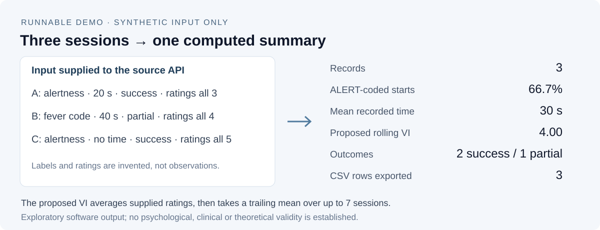

# EVT-Albert

**Emotional-Volitional Training logger and analytics toolkit**

[Albert Tan Sin Hon](https://www.alberttansinhon.com/) developed EVT-Albert as a software research prototype inspired by approaches to emotional-volitional preparation. It is intended to help a user record training or performance sessions, describe obstacles and regulation methods, and inspect simple derived indicators.

## See it in action

Three **invented sessions** go through the inspectable source API to produce
computed metrics and a three-row CSV export. Here is the observed result:



Run from the repository root with Python 3.10 or later; the demo uses only the
standard library and a temporary workspace:

```bash
python scripts/readme_demo.py
```

It prints the actual [metrics JSON](docs/demo/output.json). The
[fixture, CSV and reproduction notes](docs/demo/README.md) explain the supplied
ratings and the generated Markdown report. These results
demonstrate software arithmetic on fictional records. They do not validate the
proposed Volitional Index or a psychological theory.

## Release status

The original software in this repository is distributed under the [MIT License](LICENSE). The earlier description of the project as proprietary and non-commercial was inconsistent with that licence and has been withdrawn. MIT permits commercial and non-commercial use subject to its terms.

The version 0.1.0 source is now available under [src/evtalbert](src/evtalbert), with ordinary package metadata and tests. The source-extraction work removed the ZIP and its generated bytecode from the current tree after verifying the archive's SHA-256 and recording every original member in a [provenance manifest](docs/legacy-source-manifest.json). The original ZIP remains in Git history. Package metadata now agrees with the root MIT licence, and the Markdown writer uses real line breaks. See the [migration record](docs/SOURCE_MIGRATION.md) for the exact baseline, changes and test scope. This maintenance work does not create a new release or change the version number.

## Install and run

Use Python 3.10 or later. From a checkout, create a virtual environment and install the local package:

```bash
python -m venv .venv
. .venv/bin/activate
python -m pip install 'setuptools==84.2.1' 'wheel==0.48.0'
python -m pip install --no-build-isolation --no-deps .
evtalbert --help
```

On Windows, activate the environment with `.venv\Scripts\Activate.ps1` in PowerShell. The installed runtime uses only the Python standard library. Keep actual records in a separate private workspace and pass its path through the commands' `--root` option.

## Intended functions

- Log sport, advocacy, teaching, research or other performance sessions.
- Record pre-start states, obstacles, regulation methods and observed outcomes.
- Compute a proposed Volitional Index from purposefulness, persistence, self-control and decisiveness inputs.
- Generate a Markdown analytics summary.
- Export structured records to CSV with an option that hashes athlete identifiers.

These features organise user-supplied records. They do not diagnose a psychological or medical condition, validate the theoretical model, or establish that the proposed index measures a stable human trait.

## Public software, private records

The software may remain public. **Actual user records should not.** Do not commit session logs, health information, emotional-state records, identifiable performance histories, client information or private research data to this repository. Use a private storage location with appropriate access, retention and deletion controls. See [DATA_BOUNDARY.md](DATA_BOUNDARY.md).

## Source tests and continuous integration

After installing the package, run:

```bash
python -m unittest discover -s tests -v
python scripts/validate_source.py
python scripts/readme_demo.py --check
```

The seven tests cover the original CLI smoke flow, fixture arithmetic, a seven-session window, Markdown line breaks, empty exports, identifier hashing and invalid CLI input. All records are synthetic and all runtime workspaces temporary. The integrity workflow installs the package and runs these commands on Python 3.10 and 3.12, using pinned actions and build tools with read-only repository permissions. The demo check compares the actual metrics, CSV, Markdown and SVG against the committed examples.

## Current limitations

Passing source tests supports only the recorded software behaviour on those cases. It does not establish psychological or clinical validity, causal effectiveness, privacy assurance, production hardening or real-user usability. The proposed Volitional Index remains an unvalidated interpretation of supplied ratings. Identifier hashing leaves other fields, including free text, unchanged and does not establish anonymity.

Before relying on the software, inspect the source, reproduce the tests, examine the generated outputs and evaluate the design against the intended use. Do not use real personal or health-related records in a public test.

## Licence

MIT License, copyright 2025 Albertito Tan. See [LICENSE](LICENSE).
