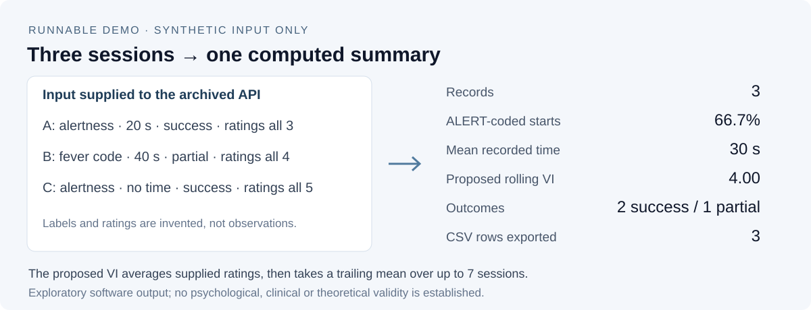

# EVT-Albert

**Emotional-Volitional Training logger and analytics toolkit**

[Albert Tan Sin Hon](https://www.alberttansinhon.com/) developed EVT-Albert as a software research prototype inspired by approaches to emotional-volitional preparation. It is intended to help a user record training or performance sessions, describe obstacles and regulation methods, and inspect simple derived indicators.

## See it in action

Three **invented sessions** go through the unchanged archived API to produce
computed metrics and a three-row CSV export. Here is the observed result:



Run from the repository root with Python 3.10 or later; the demo uses only the
standard library and a temporary workspace:

```bash
python scripts/readme_demo.py
```

It prints the actual [metrics JSON](docs/demo/output.json). The
[fixture, CSV and reproduction notes](docs/demo/README.md) explain the supplied
ratings and the legacy Markdown writer's literal `\n` separators. These results
demonstrate software arithmetic on fictional records. They do not validate the
proposed Volitional Index or a psychological theory.

## Release status

The original software in this repository is distributed under the [MIT License](LICENSE). The earlier description of the project as proprietary and non-commercial was inconsistent with that licence and has been withdrawn. MIT permits commercial and non-commercial use subject to its terms.

Version 0.1.0 is currently preserved in `evtalbert_v0_1_0.zip`. That archive is a legacy source snapshot, not the preferred long-term repository layout. A tracked maintenance task covers extraction of the source into ordinary version-controlled files, removal of generated bytecode, correction of the legacy package metadata, and reproducible source-tree continuous integration.

## Intended functions

- Log sport, advocacy, teaching, research or other performance sessions.
- Record pre-start states, obstacles, regulation methods and observed outcomes.
- Compute a proposed Volitional Index from purposefulness, persistence, self-control and decisiveness inputs.
- Generate a Markdown analytics summary.
- Export structured records to CSV with an anonymisation option.

These features organise user-supplied records. They do not diagnose a psychological or medical condition, validate the theoretical model, or establish that the proposed index measures a stable human trait.

## Public software, private records

The software may remain public. **Actual user records should not.** Do not commit session logs, health information, emotional-state records, identifiable performance histories, client information or private research data to this repository. Use a private storage location with appropriate access, retention and deletion controls. See [DATA_BOUNDARY.md](DATA_BOUNDARY.md).

## Archive-level continuous integration

The repository includes an archive-level continuous integration check for the present legacy state. It verifies the recorded archive digest, rejects unsafe ZIP paths and other structural hazards, compiles the bundled Python sources, and runs the bundled pytest smoke test through a temporary synthetic workspace.

A passing archive-level check supports only those bounded claims. It does not replace extraction into an inspectable source tree, dependency review, line-by-line code review, substantive scientific validation, privacy assessment, or evaluation with real users.

## Current limitations

The public repository has not yet been reorganised into an ordinary source tree. The preserved archive contains generated Python bytecode and legacy package metadata that still describes the package as proprietary. Those defects are recorded rather than concealed and remain part of the source-extraction task.

Before relying on the software, inspect the extracted source and dependencies, reproduce the smoke test, examine the generated outputs, and evaluate the design against the intended use. Do not use real personal or health-related records in a public test.

## Licence

MIT License, copyright 2025 Albertito Tan. See [LICENSE](LICENSE).
